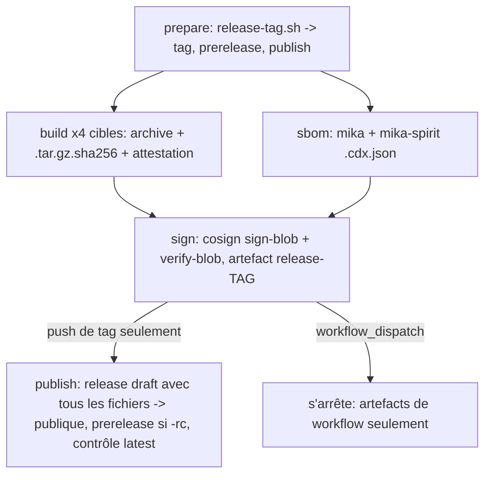

# Voie de release vérifiée pour v1.0.0 - Plan

## Goal Capsule

- **Objective:** le jour du launch, un seul geste de Vincent (pousser le tag `v1.0.0`) publie une release que `install.sh` installe et que `docs/release-verification.md` vérifie de bout en bout. Avant ce jour, un essai à blanc (tag candidat, ou run manuel) le prouve sans qu'une candidate soit jamais servie à la famille.
- **Means:** réparer `release.yml` (KTD1), qui publie la release en un seul geste à la fin et marque toute candidate en prerelease (KTD3, KTD4). Retirer release-please (KTD6).
- **Authority:** mika#2890 (AC1 à AC4) puis le brief MPC du 2026-10-23. Le tag `v1.0.0`, tout tag candidat, tout run de workflow et tout merge restent des gestes de l'opérateur.
- **Stop conditions:** le pilote s'arrête avant le push. Il ne pose aucun tag, ne lance aucun workflow et ne publie aucune release.
- **Execution profile:** interactive, worktree `release/2890/une-voie-de-release-v-rifi-e-pour-v1-0-0`. Le push est fait par samidarko, avec le jeton qui porte le scope `workflow`.

---

## Product Contract

### Summary

La voie de release est cassée à trois endroits indépendants, et chacun suffit à empêcher le launch. Ce plan les répare dans `release.yml`, retire release-please, qui ne peut pas fonctionner sur ce workspace, et passe la version à 1.0.0 avec des notes de version lisibles par la famille.

### Problem Frame

Constats relevés à la source le 2026-10-23, sur main @ 94b21916 :

1. **Pourquoi les runs v0.12.0, v0.12.1 et v0.12.2 ont fini `cancelled`.** Les runs 25571118235, 25571572348 et 25596130472 contiennent chacun le job `Build x86_64-apple-darwin` (`runs-on: macos-13`), qui n'a jamais démarré. Son annotation dit : `The job has exceeded the maximum execution time while awaiting a runner for 24h0m0s`. Les trois autres cibles ont réussi en 10 à 12 minutes. Les logs eux-mêmes ont expiré (`gh run view --log` renvoie HTTP 410), donc l'annotation est la source primaire.
2. **Aucune release ne serait créée.** `taiki-e/upload-rust-binary-action@f0d45ae` ne fait que `gh release upload` (son `main.sh:637`). Les releases v0.12.x avaient été créées par release-please, désactivé depuis mika#2047. Un tag poussé aujourd'hui n'aurait donc aucune release où envoyer ses fichiers.
3. **`install.sh` est cassé contre la release actuelle.** L'action nomme le checksum `<archive>.sha256`, alors qu'`install.sh` et `docs/release-verification.md` attendent `<archive>.tar.gz.sha256`. Exécuté contre v0.12.2, `install.sh` reçoit un 404, puis échoue sur `Checksum mismatch! Expected , got 4a16…`.
4. **Les jobs `sbom` et `sign` n'ont jamais tourné.** `cargo-cyclonedx` 0.5 écrit `<package>.cdx.json` (`generator.rs`, fonction `filename`), alors que le job copie `crates/*/bom.json`, un motif qui ne correspond à rien. Les deux jobs uploadent aussi vers une release qui peut ne pas encore exister.
5. **release-please est mort.** La stratégie `rust` échoue sur un workspace virtuel (diagnostic complet dans mika#2047), et mika#2048 a été fermé *not planned*. Le workflow ne tourne plus que sur dispatch, et un dispatch créerait une vraie PR de release sur `main`.

`install.sh` tire `releases/latest`. Pour l'API GitHub, « latest » exclut les drafts et les prereleases. Une candidate publiée sans le marqueur prerelease deviendrait donc ce que la famille installe.

### Requirements

**Publication**

- R1. Un tag `vX.Y.Z` poussé sur un commit de `main` publie une release qui contient, pour `mika` et `mika-spirit` et pour les quatre cibles d'`install.sh`, l'archive, son checksum `.tar.gz.sha256`, sa signature cosign `.bundle` et une attestation de provenance. La release contient aussi le SBOM de chaque binaire.
- R2. Un tag candidat `vX.Y.Z-rc.N` publie une release marquée **prerelease**, qui ne devient jamais « latest ». Le workflow le vérifie sur le draft avant de le rendre public, puis le revérifie après. Si l'API dit le contraire, il remet la release en draft et échoue.
- R3. Aucune release n'est visible avant que tous ses fichiers soient signés et attachés.
- R4. Un run manuel (`workflow_dispatch`, depuis `main`) produit les mêmes fichiers en artefact de workflow et ne crée aucune release.

**Gardes**

- R5. Le workflow refuse un tag qui n'a pas la forme `vX.Y.Z` ou `vX.Y.Z-rc.N`, dont la base diffère de la version du workspace, dont le commit n'est pas sur `main`, ou dont les notes de version manquent. Il refuse aussi un run manuel lancé depuis une autre ref que `main`, avant tout job qui signe ou atteste : sans cette garde, n'importe quelle branche non relue obtiendrait des archives qui passent la vérification utilisateur.

**Version et notes**

- R6. La version du workspace est `1.0.0`. Des notes de version disent en clair ce que la famille reçoit.

**Hygiène**

- R7. release-please est retiré avec sa raison. Aucun workflow ne reste rouge sur `main` en permanence.
- R8. La procédure utilisateur d'`install.sh` et de `docs/release-verification.md` ne change pas. Ce qui change, c'est le workflow, qui publie désormais les noms que cette procédure attend.

### Scope Boundaries

- Hors périmètre : poser `v1.0.0` ou tout tag candidat, lancer un workflow, publier une release, merger (AC4 et brief).
- Hors périmètre : les images Docker (`agent-image-build-push.yml`), `mika-gateway` comme binaire, l'embarquement du dashboard dans les binaires de release (placeholder vide, comme avant).
- Hors périmètre : réécrire `install.sh`. Il n'a pas besoin de changer une fois que le workflow publie le bon nom.

### Deferred to Follow-Up Work

- La preuve d'AC2 (lien du run et sortie de la vérification), à écrire dans mika#2890 après l'essai à blanc de Vincent.

---

## Planning Contract

### Key Technical Decisions

- KTD1. **Réparer `release.yml` plutôt que le remplacer par une étape manuelle.** `docs/release-verification.md` exige des signatures cosign keyless dont l'identité est `…/.github/workflows/release.yml@`, et des attestations GitHub. Une étape manuelle sur un poste ne peut produire ni l'une ni l'autre, donc elle obligerait à réécrire la procédure utilisateur, ce que l'issue interdit sauf preuve qu'elle est fausse.
- KTD2. **Construire avec `cargo build` plutôt qu'avec `upload-rust-binary-action`.** L'action fixe le nom du checksum (`<archive>.sha256`, son `main.sh:588` dit « Should we allow customizing the name »), ne crée pas la release et ne sait pas faire de prerelease. Construire, archiver et checksummer à la main tient en quelques lignes et produit exactement les noms qu'`install.sh` demande.
- KTD3. **Tout passe par des artefacts de workflow, et un seul job final publie.** Les jobs build, sbom et sign n'écrivent que des artefacts de workflow. Le job `publish`, qui ne tourne que sur un push de tag, crée la release en draft avec tous les fichiers, puis la rend publique. C'est ce qui rend R3 vrai, et R4 n'est alors que le même workflow sans son dernier job.
- KTD4. **La classe du tag est décidée par un script testé, pas dans le YAML.** `scripts/release-tag.sh` valide le tag contre la version du workspace et émet `prerelease=true|false`. Le workflow lit cette sortie et passe `--prerelease --latest=false` ou `--latest`. La règle qui protège la famille (R2) a ainsi un test hors réseau, `scripts/test-release-tag.sh`, branché dans `offline-script-suites`. (session-settled: user-directed — chosen over une RC publiée comme release normale : `install.sh` tire « latest », une RC servie à la famille est exactement le défaut à empêcher.)
- KTD5. **x86_64-apple-darwin est compilé sur `macos-14`, en cross-target depuis arm64.** C'est le label `macos-13` qui a bloqué les trois runs. `macos-14` a fait tourner aarch64-apple-darwin sans incident dans ces mêmes runs, et le SDK Xcode cible x86_64 nativement. Repli, si l'essai à blanc montre que cette cross-compilation échoue : passer cette seule cible sur un runner Intel natif, sous un label que GitHub sert encore, à vérifier dans sa documentation au moment du repli. Le binaire x86_64 n'est jamais exécuté en CI, donc seule une installation sur un Mac Intel prouve qu'il tourne.
- KTD6. **Retirer release-please.** Sont supprimés `release-pr.yml`, `release-please-config.json` et `.release-please-manifest.json`. La version et le CHANGELOG avancent à la main, dans la PR de release, comme ici. Garder un workflow dont le seul déclencheur créerait une vraie PR sur `main` revient à garder un piège.
- KTD7. **Le SBOM sur-approxime plutôt que d'omettre.** `cargo cyclonedx --all-features --target all` couvre toutes les plateformes et la feature `telemetry` des binaires publiés. Il inclut aussi les dépendances de `test-utils`. Un SBOM qui liste trop est vérifiable, un SBOM qui omet `opentelemetry` serait faux.
- KTD8. **Le job sign applique lui-même l'étape 2 de la doc.** Après signature, il lance `cosign verify-blob` avec exactement l'identité de `docs/release-verification.md`. Si la doc et le workflow divergent, c'est le workflow qui échoue, pas l'utilisateur.

### High-Level Technical Design

Directionnel, ce n'est pas une spécification :

Table de décision de `scripts/release-tag.sh <tag> <version-workspace>` :

| Tag | Version workspace | Sortie |
|---|---|---|
| `v1.0.0` | `1.0.0` | `prerelease=false` |
| `v1.0.0-rc.1` | `1.0.0` | `prerelease=true` |
| `v1.0.1` | `1.0.0` | refus : base différente |
| `v1.0.0-beta` | `1.0.0` | refus : forme non reconnue |
| `1.0.0` | `1.0.0` | refus : `v` manquant |

### Assumptions

- La cross-compilation arm64 vers x86_64 d'`aws-lc-sys` et de `libsqlite3-sys` sur `macos-14` passe avec le SDK Xcode. C'est le premier point que l'essai à blanc prouve ou réfute.
- `gh release create` avec `--draft`, `--prerelease` et `--latest=false`, puis `gh release edit --draft=false`, se comporte comme documenté par le gh CLI préinstallé sur `ubuntu-22.04`.
- `cosign-installer@v4` installe un cosign dont `sign-blob --bundle` produit un bundle que `verify-blob --bundle` accepte, ce qui est la forme de la doc.

---

## Implementation Units

### U1. Script de classe de tag et son test

- **Goal:** décider, hors réseau et de façon testée, si un tag est publiable et s'il est candidat.
- **Requirements:** R2, R5 (KTD4).
- **Files:** `scripts/release-tag.sh`, `scripts/test-release-tag.sh`, `Makefile` (cible `check-release-tag`), `.github/workflows/ci.yml` (une étape dans `offline-script-suites`).
- **Approach:** POSIX/bash. Arguments : tag et version du workspace. Sortie : lignes `key=value` (`tag`, `base`, `prerelease`) adaptées à `$GITHUB_OUTPUT`. Refus avec exit non nul et message sur stderr.
- **Test scenarios:** les cinq lignes de la table ci-dessus. Ajouter `v1.0.0-rc.12` (prerelease), un argument manquant (refus), et `v1.0.0-rc.` (refus).
- **Verification:** `bash scripts/test-release-tag.sh` vert, et `make check-suite-wiring` vert, puisque la nouvelle suite est atteinte par un workflow.

### U2. `release.yml` réécrit

- **Goal:** la voie de KTD1 à KTD3, KTD5, KTD7 et KTD8.
- **Requirements:** R1, R2, R3, R4, R5, R8.
- **Dependencies:** U1.
- **Files:** `.github/workflows/release.yml`.
- **Approach:**
  - **Déclencheurs.** `push: tags: v*`, et `workflow_dispatch` avec une entrée `tag` (par exemple `v1.0.0-rc.1`), qui ne sert qu'à nommer les fichiers.
  - **`prepare`.** Il fait un checkout avec `fetch-depth: 0`, sans quoi `origin/main` est absent sur un push de tag. Il refuse un dispatch dont `github.ref` n'est pas `refs/heads/main`. Il extrait la version du workspace et appelle U1. Il vérifie `git merge-base --is-ancestor "$GITHUB_SHA" origin/main`, puis l'existence de `docs/releases/v<base>.md`. Il émet `publish=true` sur un push de tag seulement.
  - **Interpolation.** `inputs.tag` et `github.ref_name` n'atteignent le shell que par `env:`. Les jobs suivants n'utilisent que les sorties de `prepare`.
  - **`build`.** La matrice garde ses quatre cibles, avec `rustup show` (qui lit `rust-toolchain.toml`) puis `rustup target add`. Le checksum est calculé dans le répertoire de l'archive (`shasum -a 256 <archive>.tar.gz`, présent sur les deux runners), donc le fichier contient `<hash>  <nom nu>`, que lisent `install.sh` comme `sha256sum --check`.
  - **`sbom`.** Il installe `cargo install cargo-cyclonedx --version 0.5.9 --locked`, puis publie exactement deux fichiers : `crates/mika-cli/mika-cli.cdx.json` renommé `mika-<tag>-sbom.cdx.json`, et `crates/mika-agent/mika-agent.cdx.json` renommé `mika-spirit-<tag>-sbom.cdx.json`. Il échoue si l'un manque.
  - **`sign`.** Il suit `build` et `sbom`.
  - **`publish`.** Il tourne sous `if: needs.prepare.outputs.publish == 'true'`. S'il existe déjà une release publiée pour ce tag, il échoue. S'il existe un draft, il le supprime, pour qu'une relance soit sûre. Il crée la release en draft avec tous les fichiers, avec `--prerelease` selon la sortie de U1. Il vérifie le drapeau prerelease du draft, puis le rend public avec `--latest=false` ou `--latest`. Il relit enfin `releases/latest` : pour une candidate, ce ne doit pas être ce tag ; pour une finale, ce doit l'être. En cas de désaccord, il remet la release en draft et échoue.
  - **Permissions et actions.** Les permissions sont fixées job par job : `id-token: write` et `attestations: write` sur `build`, `id-token: write` sur `sign`, `contents: write` sur `publish` seulement. Les actions sont épinglées par SHA. Un `concurrency` par tag empêche deux runs simultanés de supprimer le draft l'un de l'autre.
- **Test expectation:** pas de test local d'un workflow GitHub. La preuve est l'essai à blanc (AC2), et le YAML est vérifié par analyse statique : parse YAML, et `actionlint` s'il est disponible.
- **Verification:** relecture des noms de fichiers produits contre `install.sh` (`${URL}.sha256`, `${BINARY}` à la racine de l'archive) et contre `docs/release-verification.md` (`mika-<tag>-sbom.cdx.json`, `.bundle`, identité cosign).

### U3. Retrait de release-please

- **Goal:** R7 (KTD6).
- **Files:** suppression de `.github/workflows/release-pr.yml`, `release-please-config.json` et `.release-please-manifest.json`, et de leurs deux entrées dans `scripts/root-files-declared.txt`. Retrait des conditions `release-please--` devenues mortes dans `.github/workflows/ci.yml`. Mises à jour de `scripts/check-suite-wiring.sh` (commentaire « Third limit »), `docs/deployment.md` § 3c et `CLAUDE.md` (liste des workflows, label `release`).
- **Test expectation:** none, c'est un retrait de configuration. `make check-suite-wiring` et `make check-root-files` doivent rester verts.

### U4. Version 1.0.0 et notes de version

- **Goal:** R6.
- **Files:** `Cargo.toml` (`[workspace.package] version`), `Cargo.lock` (les six crates du workspace), `CHANGELOG.md` (entrée `v1.0.0`), `docs/releases/v1.0.0.md` (nouveau, lu par `publish` comme corps de la release).
- **Approach:** les notes parlent à la famille : ce que Mika fait, comment l'installer, comment vérifier, et ce qui n'est pas dans le binaire (gateway, dashboard).
- **Test expectation:** `cargo build` régénère le lock. `crates/mika-common/tests/claude_md_size.rs` et les tests existants restent verts.

### U5. Documentation de la voie

- **Goal:** l'étape opérateur est écrite dans le dépôt (AC1, AC2).
- **Files:** `docs/releasing.md` (nouveau : essai à blanc, launch, checklist de vérification, retour arrière), `docs/deployment.md` (§ Release Binaries), et `docs/release-verification.md` seulement si U2 en change un nom.
- **Approach:** l'essai à blanc recommandé est le tag candidat, parce qu'il exerce le job `publish` et qu'il permet d'exécuter `install.sh <tag>` puis le binaire installé, sous Linux et sous macOS. La procédure de vérification seule n'extrait jamais l'archive : c'est exactement le genre de défaut, un nom ou une disposition qui diverge d'`install.sh`, qui a cassé v0.12.2. Le run manuel reste un outil de mise au point. La doc dit aussi qu'une relance de `publish` est sûre, qu'un run manuel hors `main` est refusé, et qu'une règle de tag GitHub sur `refs/tags/v*`, réservée à l'opérateur, rendrait AC4 structurel. Poser cette règle est un geste opérateur.
- **Test expectation:** none, c'est de la documentation. Le job `docs-sync` exige `scripts/sync-agent-docs.sh` si un fichier synchronisé change.

---

## Verification Contract

| Commande | Prouve |
|---|---|
| `bash scripts/test-release-tag.sh` | R2, R5 : la classe de tag |
| `make check-suite-wiring` | la nouvelle suite est atteinte |
| `cargo fmt --all -- --check`, `cargo clippy --all-targets --all-features -- -D warnings`, `cargo test` | le passage en 1.0.0 ne casse rien |
| `make lint` et les scripts `check-*` du dépôt | les lints du dépôt |
| `bash scripts/verify-pipeline.sh origin/main` | les artefacts du pipeline |
| parse YAML de `release.yml` et `ci.yml` (et `actionlint` si présent) | le workflow est bien formé |
| `make check-root-files` | le registre des fichiers racine suit le retrait de release-please |
| essai à blanc par Vincent sur `v1.0.0-rc.1` (`docs/releasing.md`) | AC2, plus R2 côté publication (`--latest=false` et contrôle de `releases/latest`) ; hors de ce vol |

## Definition of Done

- U1 à U5 sont faits, et chaque ligne du Verification Contract hors essai à blanc est verte.
- Aucun tag, aucune release, aucun run de workflow, aucun push.
- Le diff ne contient aucun reste de tentative abandonnée.

## Acceptance criteria

- [ ] AC1. Il existe une voie de release qui marche : `release.yml` réparé, avec l'étape opérateur documentée dans `docs/releasing.md`. `release-pr.yml` est retiré avec sa raison, et aucun workflow ne reste rouge sur main en permanence.
- [ ] AC2. Un essai à blanc est prouvé avant le jour J, sur un tag candidat (`v1.0.0-rc.1`) ou par un run manuel. Il produit les artefacts, les checksums, les signatures et le SBOM, et la procédure de `docs/release-verification.md` passe sur ces artefacts. La preuve (lien du run et sortie de la vérification) est écrite dans mika#2890. Ce vol livre la voie et la commande ; l'essai lui-même revient à l'opérateur.
- [ ] AC3. La version du workspace est `1.0.0`, et des notes de version disent ce que la famille reçoit.
- [ ] AC4. Le tag `v1.0.0` reste le geste de Vincent le jour du launch. Le vol s'arrête avant ce tag, et le tag candidat, s'il en faut un, est posé par l'opérateur.
- [ ] Un tag `-rc.N` est classé prerelease : `scripts/test-release-tag.sh` le prouve hors réseau. Qu'il ne devienne jamais « latest » repose sur `--latest=false` et sur le contrôle de `releases/latest` dans `publish`, et seul l'essai à blanc le prouve.
